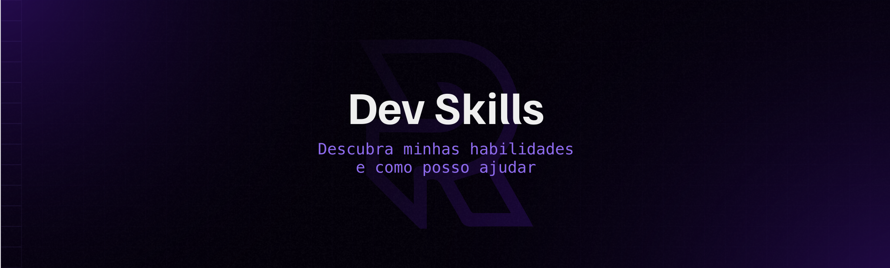

<h2>Hello World!  I'm Rener Pires</h2>

  

 

💻 You can find my projects on my <a href="https://renerpires.dev">portfolio</a>

🔧 Currently working on an automated testing tool

🌱 Learning: Azure DevOps

👨🏽‍💻 Open to collaborating on open-source projects

💬 Ask me about… anything tech-related (or horror movies!)

⚡ Fun fact: I run a side project translating a horror storytelling podcast (EN → PT-BR)

---

### 🧠 About Me

I’m a **Senior Software Engineer** passionate about frontend architecture, API design, and automation tools.

I love building elegant, reliable user experiences using **React**, **Next.js**, **TypeScript**, and **TailwindCSS** — and I’m equally at home designing scalable systems powered by **Node.js**, **PostgreSQL**, and **Docker**.

Outside of work, I contribute to developer communities and experiment with creative coding projects combining design, storytelling, and data visualisation.

---

<h2>Some of the technologies I work with 👨🏽‍💻</h2>

---

### 🤝 Let's Connect

