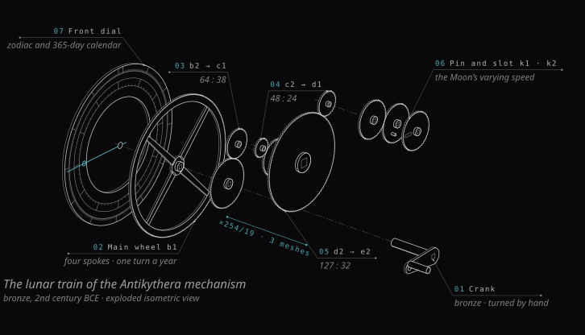

  

**Software is a craft before it is a product.** I lead engineering teams and design the systems they build. Ten-plus engineers, five-plus years of leading, one obsession: resilient systems and teams that own what they build.

### 01 · Now

Tech lead and solutions architect at **CFP Energy**, on **Centrii**: OT cybersecurity for renewable energy, from an API-first core to the AI agents that help analysts act. London, with São Paulo in the heart.

### 02 · How I lead

**I. Cleverness over micromanagement.** Hire sharp people, give them context and room, and get out of the way. Control does not scale; clarity does.

**II. Best practices, by default.** Reviews, tests, documentation and observability are how a team moves fast for years, not weeks.

**III. Ownership.** Whoever builds it, owns it: from the first sketch to the 3 a.m. alert.

 

### 03 · Systems, by hand

  

The Antikythera mechanism is the oldest analogue computer we know of: a hand crank, a train of bronze gears, and the Moon's motion falls out of honest ratios, 254 orbits in 19 years. It is how I like systems to be built. Every part has a reason to exist, every ratio is written down, and nothing important hides behind magic. When something breaks, you can open the case and follow the gears.

### 04 · Selected work

- **Centrii**, OT cybersecurity for wind, solar and battery sites.
- **CERC**, the systems that register Brazil's credit instruments.
- **Vericode**, from trainee to tech lead, building test automation and a quality culture.
- **[Quicky](https://github.com/RenerPires?tab=repositories&q=quicky)**, no-faff helpers for end-to-end automation.

### 05 · Off the clock

  

I play the cello, mostly Bach, and keep company with sad philosophers: Spinoza, Nietzsche, Dostoyevsky, Kafka. Taken apart, the cello and the bass clarinet read like a field guide to leading: the bridge turns the strings' pull into a voice, the sound post holds the shape without ever being seen, and the bell reminds you that the lowest notes need room to ring. The score beside them is *B Flat After Dusk*, a duet I wrote for the two. Elsewhere, I am dubbing *The Magnus Archives* into Brazilian Portuguese and building a quiet editor for notes and maths.

  

  
  
  
  
  
  
  
  
  
  
  
  
  
  
  
  
  

### 07 · Elsewhere

[renerpires.dev](https://renerpires.dev) · [LinkedIn](https://linkedin.com/in/renerpires) · [Medium](https://medium.com/@renerpires) · [Dev.to](https://dev.to/renerpires) · [Instagram](https://www.instagram.com/renerpires.dev/)

Fig. I is a photograph set in characters. The Prometheus behind the header is original artwork made for renerpires.dev, and the fine-line figures are drawn there too.

